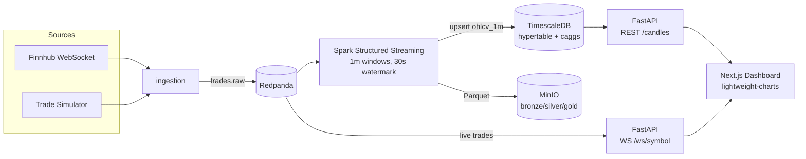
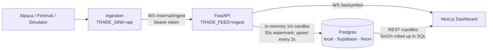

# Stock Streaming Platform

Real-time US stock market streaming pipeline — from raw trades to a live candlestick
dashboard — built as a portfolio project on a fully containerized stack.

**Stack:** Redpanda (Kafka) · Spark Structured Streaming · TimescaleDB · MinIO ·
FastAPI · Next.js + lightweight-charts

## Architecture



## Quickstart

```bash
cp .env.example .env        # defaults work out of the box (simulator mode)
docker compose up -d --build
```

| UI | URL |
|---|---|
| Dashboard | http://localhost:3000 |
| API docs (OpenAPI) | http://localhost:8000/docs |
| Redpanda Console | http://localhost:8080 |
| MinIO Console | http://localhost:9001 |

No market data API key required: by default `TRADE_SOURCE=simulator` generates
synthetic trades (random walk) so the whole pipeline runs 24/7 — even when US
markets are closed. For real data set `TRADE_SOURCE=alpaca` + `ALPACA_API_KEY` /
`ALPACA_API_SECRET` (free IEX feed), or `TRADE_SOURCE=finnhub` + `FINNHUB_API_KEY`.

## Lite stack (production, ~1 GB VM)

The full stack needs ~4–5 GB RAM. `docker-compose.prod.yml` runs the same dashboard
without Redpanda, Spark or MinIO, in well under 512 MB:



```bash
make lite-up                # api + ingestion + local Postgres + dashboard (profile "local")
make backfill DAYS=5        # optional: historical 1m bars from Alpaca
```

Without `--profile local` only `api` + `ingestion` start; point `PG_*` at a managed
Postgres and host the frontend on Vercel. Measured memory: api ~55 MB, ingestion ~35 MB.

## Design notes

- **Event-time processing:** Spark aggregates OHLCV with 1-minute event-time windows
  and a 30s watermark, so late trades still land in the right candle.
- **Medallion layout on MinIO:** raw trades → bronze Parquet; aggregates → silver.
- **Serving layer:** TimescaleDB hypertable `ohlcv_1m` with continuous aggregates
  (`ohlcv_5m`, `ohlcv_1h`) for cheap multi-interval reads.
- **Environment-aware processing:** Spark for dev; on memory-constrained VMs the API
  aggregates candles itself (`api/src/aggregator.py`, same watermark semantics) and
  ingestion pushes trades to it directly instead of through Kafka. On startup it reloads
  the last two minutes from the DB so a restart mid-minute does not truncate a candle.
- **Portable schema:** `001_schema.sql` is plain Postgres; only `002_hypertables.sql`
  needs TimescaleDB. With `CANDLE_ROLLUP=sql` the API builds 5m/1h candles with
  `date_bin()` instead of continuous aggregates (Supabase/Neon don't offer them).

## Roadmap

- [x] Local stack: ingestion → Redpanda → Spark → TimescaleDB/MinIO → API → dashboard
- [ ] CI/CD (GitHub Actions → GHCR, SSH deploy)
- [x] Lite stack for small VMs (`docker-compose.prod.yml`)
- [x] Alpaca source (real-time IEX trades) + historical 1m backfill
- [ ] Managed Postgres (Supabase) + watchlists
- [ ] News summaries + alerts
- [ ] Deploy: Oracle Cloud VM + Caddy
