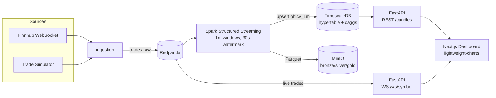

# Stock Streaming Platform

Real-time US stock market streaming pipeline — from raw trades to a live candlestick
dashboard — built as a portfolio project on a fully containerized stack.

**Stack:** Redpanda (Kafka) · Spark Structured Streaming · TimescaleDB · MinIO ·
FastAPI · Next.js + lightweight-charts

## Architecture



## Quickstart

```bash
cp .env.example .env        # defaults work out of the box (simulator mode)
docker compose up -d --build
```

| UI | URL |
|---|---|
| Dashboard | http://localhost:3000 |
| API docs (OpenAPI) | http://localhost:8000/docs |
| Redpanda Console | http://localhost:8080 |
| MinIO Console | http://localhost:9001 |

No market data API key required: by default `TRADE_SOURCE=simulator` generates
synthetic trades (random walk) so the whole pipeline runs 24/7 — even when US
markets are closed. Set `TRADE_SOURCE=finnhub` + `FINNHUB_API_KEY` for real data.

## Design notes

- **Event-time processing:** Spark aggregates OHLCV with 1-minute event-time windows
  and a 30s watermark, so late trades still land in the right candle.
- **Medallion layout on MinIO:** raw trades → bronze Parquet; aggregates → silver.
- **Serving layer:** TimescaleDB hypertable `ohlcv_1m` with continuous aggregates
  (`ohlcv_5m`, `ohlcv_1h`) for cheap multi-interval reads.
- **Environment-aware processing:** Spark for dev; a lite Python aggregator (planned)
  replaces it on memory-constrained production VMs via `docker-compose.prod.yml`.

## Roadmap

- [x] Local stack: ingestion → Redpanda → Spark → TimescaleDB/MinIO → API → dashboard
- [ ] CI/CD (GitHub Actions → GHCR, SSH deploy)
- [ ] Lite aggregator for small VMs
- [ ] Airflow historical backfill (yfinance)
- [ ] Deploy: Oracle Cloud VM + Caddy
